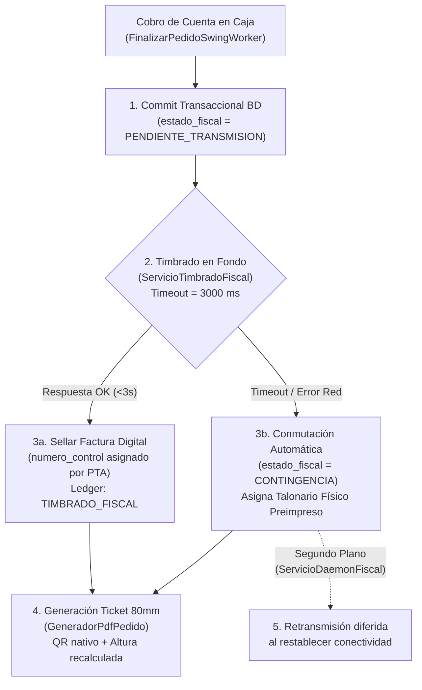

# Plan de Adecuación Fiscal — SENIAT Providencia SNAT/2026/00093
**Sistema:** Restaurante 2026 (Java 21 + Swing + MySQL 8.4)  
**Normativa:** Providencia Administrativa N° SNAT/2026/00093 — Gaceta Oficial N° 43.484 del 21/10/2026  
**Plazo legal de adecuación:** 180 días continuos desde el 21/10/2026 (vence ≈ 19/04/2027)  
**Estado del plan:** **PLAN MAESTRO v0.3** — Arquitectura integral, concurrencia auditada, Notas de Crédito, IGTF, Libro de Ventas y Mock de pruebas.

> [!IMPORTANT]
> Este documento es una especificación técnica de ingeniería de software para adecuación fiscal.
> No reemplaza el dictamen vinculante de un asesor tributario colegiado ante el SENIAT.
> Debe validarse formalmente con el Proveedor Tecnológico Autorizado (PTA) y el contador del restaurante.

---

## Tabla de Estado de Cumplimiento Normativo

| Exigencia Providencia SNAT/2026/00093 | Estado actual | Brecha técnica | Solución en Plan v0.3 |
|---|---|---|---|
| Expresión dual USD + Bs. con tasa BCV | ✅ Cumple | Ninguna | Nativo en `CalculoFiscalRecord` y `GeneradorPdfPedido` |
| Discriminación Base Imponible / Exentos | ✅ Cumple | Ninguna | Persistido en `detalle_pedidos` y reportes |
| Datos fiscales emisor (RIF, Razón Social) | ✅ Cumple | Ninguna | Configurado en tabla `config` |
| Datos del receptor (Cédula/RIF, Nombre) | ✅ Cumple | Ninguna | Mapeado en `pedidos` y tabla `clientes` |
| Trazabilidad inmutable (Ledger Hash) | ✅ Cumple | Ninguna | `ServicioLedgerFiscal` con HMAC-SHA256 |
| Correlativo único de factura | ⚠️ Parcial | Usa ID interno `#00000001` | Requiere Número de Control Fiscal formal |
| Número de Control Fiscal (Art. 4) | ❌ No cumple | No asignado ni recibido de PTA | Adecuación 1, 2 y 4 (PTA + Contingencia) |
| Código QR de validación fiscal en comprobante | ❌ No cumple | No generado en tickets | Adecuación 6 (`BarcodeQRCode` iText nativo) |
| IGTF 3% en pagos con divisas (Sujeto Pasivo Especial) | ❌ No cumple | No calculado en cobros USD | Adecuación 3 (`IgtfRecord` + `PlanPagosCobro`) |
| Notas de Crédito Fiscales Digitales por Anulación | ❌ No cumple | `ANULADO` solo revierte contabilidad interna | Adecuación 5 (`ServicioTimbradoFiscal.emitirNotaCredito`) |
| Transmisión asíncrona y daemon de resincronización | ❌ No cumple | No conectado a entes fiscales | Adecuación 4 (`ServicioDaemonFiscal` virtual thread) |
| Registro formal de contingencia física con rango | ❌ No cumple | No valida imprenta autorizada ni rangos | Adecuación 1.3 y 4.3 (Control de talonarios autorizados) |
| Cierre Z con desglose fiscal y Libro de Ventas | ❌ No cumple | Solo consolida totales monetarios | Adecuación 7 (Cierre Z discriminado + Exportador Libro Ventas) |
| Leyenda legal en comprobante impreso | ❌ No cumple | Pie de página genérico | Adecuación 6 (Texto formal providencia SNAT/2026/00093) |

---

## Decisión de Arquitectura: Estrategia Híbrida de Transmisión

La Providencia SNAT/2026/00093 autoriza dos canales para emisión electrónica directa (Proveedor Tecnológico Autorizado o Portal SENIAT) y contempla la emisión física excepcional ante fallas de fuerza mayor.



1. **Canal Primario:** Proveedor Tecnológico Autorizado (PTA) vía REST API con TLS 1.3 y timeout estricto de **3.000 ms**.
2. **Canal de Contingencia Inmediata:** Si el PTA no responde en 3 segundos o no hay conectividad, la aplicación **no se congela ni bloquea al cajero**: conmuta a talonario físico de contingencia, emite el ticket con la advertencia legal y marca la factura como `PENDIENTE_TRANSMISION` o `CONTINGENCIA`.
3. **Daemon de Retransmisión en Fondo:** Un hilo virtual (Java 21) sincroniza facturas diferidas en lotes cuando la conectividad se restablece.

---

## Adecuación 1 — Esquema de Base de Datos (Migración v18)

**Archivos a sincronizar byte-a-byte:**
- `BD.sql`
- `actualizar_bd.sql`
- `db/migrations/actualizar_bd.sql`
- `src/infraestructura/MigradorEsquemaJdbc.java` (constante `CHECKSUM_MIGRACION_V18`)

### 1.1 Modificaciones en tabla `pedidos`

```sql
-- ============================================================================
-- Migración v18: Soporte Facturación Digital SENIAT Providencia SNAT/2026/00093
-- ============================================================================
ALTER TABLE pedidos
  ADD COLUMN IF NOT EXISTS numero_control       VARCHAR(30)   NULL     COMMENT 'Número de control fiscal formal asignado por PTA o imprenta',
  ADD COLUMN IF NOT EXISTS sello_digital        TEXT          NULL     COMMENT 'Token de autenticidad criptográfica devuelto por el PTA',
  ADD COLUMN IF NOT EXISTS url_validacion       VARCHAR(500)  NULL     COMMENT 'URL para consulta pública del comprobante en el portal fiscal',
  ADD COLUMN IF NOT EXISTS estado_fiscal        ENUM(
      'PENDIENTE_TRANSMISION',  -- Factura cobrada en BD, esperando confirmación de transmisión
      'TRANSMITIDA',            -- Confirmada formalmente por el PTA / SENIAT
      'CONTINGENCIA',           -- Emitida en talonario físico autorizado durante corte/falla
      'RECHAZADA',              -- Rechazada formalmente por inconsistencia fiscal
      'NO_APLICA'               -- Pedidos legacy anteriores a la migración
  ) NOT NULL DEFAULT 'NO_APLICA'                                       COMMENT 'Estado en el flujo de facturación electrónica',
  ADD COLUMN IF NOT EXISTS es_contingencia      TINYINT(1)    NOT NULL DEFAULT 0 COMMENT '1 = emitida con respaldo de talonario físico',
  ADD COLUMN IF NOT EXISTS nro_talonario        VARCHAR(30)   NULL     COMMENT 'Número de documento en talonario físico si es contingencia',
  ADD COLUMN IF NOT EXISTS transmitida_en       DATETIME      NULL     COMMENT 'Fecha y hora exacta de respuesta exitosa del PTA',
  ADD COLUMN IF NOT EXISTS igtf_total_usd       DECIMAL(18,2) NOT NULL DEFAULT 0.00 COMMENT 'Total IGTF percibido en USD',
  ADD COLUMN IF NOT EXISTS igtf_total_bs        DECIMAL(18,2) NOT NULL DEFAULT 0.00 COMMENT 'Total IGTF percibido en Bs a tasa BCV',
  ADD COLUMN IF NOT EXISTS nc_numero_control    VARCHAR(30)   NULL     COMMENT 'Número de control de la Nota de Crédito en caso de anulación',
  ADD COLUMN IF NOT EXISTS nc_transmitida_en    DATETIME      NULL     COMMENT 'Timestamp de transmisión de la Nota de Crédito',
  ADD KEY IF NOT EXISTS idx_pedidos_estado_fiscal (estado_fiscal),
  ADD KEY IF NOT EXISTS idx_pedidos_daemon_reintento (estado_fiscal, id);
```

### 1.2 Modificaciones en tabla `pedido_pagos`

```sql
ALTER TABLE pedido_pagos
  ADD COLUMN IF NOT EXISTS igtf_porcentaje      DECIMAL(5,2)  NOT NULL DEFAULT 0.00 COMMENT 'Alícuota IGTF aplicada a este tramo (3.00 si aplica)',
  ADD COLUMN IF NOT EXISTS igtf_monto_usd       DECIMAL(18,2) NOT NULL DEFAULT 0.00 COMMENT 'Monto percibido por IGTF en USD',
  ADD COLUMN IF NOT EXISTS igtf_monto_bs        DECIMAL(18,2) NOT NULL DEFAULT 0.00 COMMENT 'Monto percibido por IGTF en Bs a tasa del pedido';
```

### 1.3 Nuevas claves en `configuracion_sistema` (sin DDL adicional)

Gestionadas dinámicamente mediante `ConfiguracionRepositorio`:

| Clave (`ConfigClaves`) | Tipo | Default | Descripción operativa |
|---|---|---|---|
| `fiscal_proveedor_url` | String | `""` | URL del endpoint REST del PTA |
| `fiscal_proveedor_token` | String | `""` | Token de autenticación Bearer API del PTA |
| `fiscal_modo_transmision` | Enum | `PROVEEDOR` | `PROVEEDOR` \| `SENIAT_DIRECTO` \| `CONTINGENCIA` |
| `fiscal_rif_contribuyente` | String | `""` | RIF fiscal del comercio emisor (ej. `J-12345678-9`) |
| `fiscal_proveedor_nombre` | String | `""` | Razón social del PTA contratado |
| `fiscal_timeout_ms` | Integer | `3000` | Timeout estricto de conexión HTTP (máx recomendado: 3000) |
| `fiscal_es_contribuyente_especial` | Boolean | `false` | `true` activa retención/percepción del 3% IGTF en divisas |
| `fiscal_alicuota_igtf` | Decimal | `3.00` | Porcentaje vigente de alícuota IGTF |
| `fiscal_daemon_intervalo_s` | Integer | `60` | Frecuencia de escaneo en segundos para facturas pendientes |
| `fiscal_contingencia_talonario_desde` | Integer | `1` | Rango inicial autorizado por imprenta para contingencia |
| `fiscal_contingencia_talonario_hasta` | Integer | `500` | Rango final autorizado por imprenta para contingencia |
| `fiscal_contingencia_talonario_actual` | Integer | `1` | Próximo número físico disponible en talonario |
| `fiscal_contingencia_autorizacion_seniat` | String | `""` | Número de providencia o autorización de imprenta |

---

## Adecuación 2 — Registro Formal de Migración en `MigradorEsquemaJdbc`

**Archivo:** `src/infraestructura/MigradorEsquemaJdbc.java`

Para preservar la regla estricta de seguridad auditada por `InstaladoresSeguridadTest`:
1. Subir `VERSION_ESQUEMA` de `17` a `18`.
2. Declarar `DEFINICION_MIGRACION_V18` con el DDL exacto.
3. Computar `CHECKSUM_MIGRACION_V18 = calcularChecksum(DEFINICION_MIGRACION_V18)`.
4. Implementar `migrarV18(Connection con)` invocando `ejecutarMigracion(...)`.
5. Comprobar que `actualizar_bd.sql` y `db/migrations/actualizar_bd.sql` sean **idénticos byte a byte**.

---

## Adecuación 3 — Módulo de IGTF y Lógica Monetaria

### 3.1 Entidad Inmutable `IgtfRecord`

```java
package Modelo;

import java.math.BigDecimal;
import java.math.RoundingMode;
import java.util.Objects;

/**
 * Representa el cálculo formal de percepción del Impuesto a las Grandes
 * Transacciones Financieras (IGTF 3%) según la Reforma Parcial de la Ley del IGTF
 * y Providencia SNAT/2022/000013.
 */
public record IgtfRecord(
        BigDecimal baseImponibleUsd,
        BigDecimal porcentaje,
        BigDecimal montoIgtfUsd,
        BigDecimal baseImponibleBs,
        BigDecimal montoIgtfBs) {

    public static final BigDecimal ALICUOTA_DEFECTO = new BigDecimal("3.00");

    public IgtfRecord {
        Objects.requireNonNull(baseImponibleUsd, "baseImponibleUsd no puede ser nula");
        Objects.requireNonNull(porcentaje, "porcentaje no puede ser nulo");
        Objects.requireNonNull(montoIgtfUsd, "montoIgtfUsd no puede ser nulo");
        Objects.requireNonNull(baseImponibleBs, "baseImponibleBs no puede ser nula");
        Objects.requireNonNull(montoIgtfBs, "montoIgtfBs no puede ser nulo");
    }

    public static IgtfRecord calcular(BigDecimal totalPagosDivisaUsd, BigDecimal tasaCambio, BigDecimal alicuota) {
        if (totalPagosDivisaUsd == null || totalPagosDivisaUsd.signum() <= 0) {
            return vacio();
        }
        BigDecimal pct = alicuota != null ? alicuota : ALICUOTA_DEFECTO;
        BigDecimal baseUsd = totalPagosDivisaUsd.setScale(2, RoundingMode.HALF_UP);
        BigDecimal igtfUsd = baseUsd.multiply(pct)
                .divide(new BigDecimal("100"), 2, RoundingMode.HALF_UP);
        BigDecimal baseBs = baseUsd.multiply(tasaCambio).setScale(2, RoundingMode.HALF_UP);
        BigDecimal igtfBs = igtfUsd.multiply(tasaCambio).setScale(2, RoundingMode.HALF_UP);

        return new IgtfRecord(baseUsd, pct, igtfUsd, baseBs, igtfBs);
    }

    public static IgtfRecord vacio() {
        return new IgtfRecord(BigDecimal.ZERO, BigDecimal.ZERO, BigDecimal.ZERO, BigDecimal.ZERO, BigDecimal.ZERO);
    }

    public boolean tieneIgtf() {
        return montoIgtfUsd.signum() > 0;
    }
}
```

### 3.2 Impacto en `PlanPagosCobro` y `DialogoCobroPedido`

- **Regla Operativa:** El IGTF es un tributo que el comercio Sujeto Pasivo Especial **percibe** del cliente. Si el pedido totaliza $50.00 y el cliente entrega $50.00 en efectivo USD, el IGTF causado es de $1.50 (3%).
- En la interfaz de cobro `DialogoCobroPedido`:
  - Se añade un indicador reactivo: `lblIgtfEstimado: "IGTF Percibido (3%): $1.50 / Bs. 75.00"`.
  - El saldo a cubrir se ajusta dinámicamente si la política de la empresa traslada el IGTF al total del comprobante: `Total con IGTF: $51.50`.
  - Si el pago es en Bolívares (`EFECTIVO_BS`, `PAGO_MOVIL`, `PUNTO/TARJETA`), el IGTF es automáticamente `$0.00`.

---

## Adecuación 4 — Arquitectura de Transmisión Asíncrona (Sin Bloqueo del EDT)

### 4.1 Abstracción `ServicioTimbradoFiscal`

```java
package Servicio;

import Modelo.Pedidos;
import Modelo.ResultadoTimbradoFiscal;

public interface ServicioTimbradoFiscal {

    /**
     * Timbra una Factura FINALIZADA ante el canal configurado.
     * Debe llamarse FUERA del EDT (hilo virtual o SwingWorker.doInBackground).
     * Timeout acotado internamente a fiscal_timeout_ms (default 3s).
     */
    ResultadoTimbradoFiscal timbrarFactura(Pedidos pedido);

    /**
     * Emite una Nota de Crédito Electrónica ante la anulación de una Factura cobrada.
     */
    ResultadoTimbradoFiscal emitirNotaCredito(Pedidos pedidoOriginal, String motivoAnulacion, String usuario);

    /**
     * Comprueba conectividad y estado operativo del servicio fiscal.
     */
    boolean verificarConexion();
}
```

### 4.2 Registro Inmutable `ResultadoTimbradoFiscal`

```java
package Modelo;

import java.time.Instant;

public record ResultadoTimbradoFiscal(
        boolean exitoso,
        String numeroControl,
        String selloDigital,
        String urlValidacion,
        boolean esContingencia,
        String nroTalonario,
        String mensajeError,
        Instant transmitidaEn) {

    public static ResultadoTimbradoFiscal exitoDigital(String control, String sello, String url) {
        return new ResultadoTimbradoFiscal(true, control, sello, url, false, null, null, Instant.now());
    }

    public static ResultadoTimbradoFiscal contingencia(String nroTalonario, String motivo) {
        return new ResultadoTimbradoFiscal(false, null, null, null, true, nroTalonario, motivo, null);
    }

    public static ResultadoTimbradoFiscal falloReintentable(String error) {
        return new ResultadoTimbradoFiscal(false, null, null, null, false, null, error, null);
    }
}
```

### 4.3 Orquestación en `FinalizarPedidoSwingWorker`

El punto de enganche exacto para cumplir `java-concurrency-edt-audit` y evitar bloqueos:

```
[EDT] Usuario presiona 'Cobrar' en DialogoCobroPedido
  ↓
FinalizarPedidoSwingWorker.doInBackground() [HILO DE TRABAJO]
  │
  ├── 1. controlador.finalizarPedidoConCliente(...)
  │        └── PedidosDao.cobrarPedido() [TRANSACCIÓN JDBC ATÓMICA]
  │              ├── UPDATE pedidos SET estado='FINALIZADO', estado_fiscal='PENDIENTE_TRANSMISION'
  │              ├── INSERT pedido_pagos (incluye columnas igtf_*)
  │              ├── ServicioLedgerFiscal.registrarFactura(...) [sella bloque FAC-X]
  │              └── COMMIT (la venta ya es jurídicamente válida en BD)
  │
  ├── 2. servicioTimbradoFiscal.timbrarFactura(pedido) [HTTP REST, Timeout 3000ms]
  │        ├── CASO A (Éxito < 3s):
  │        │     ├── pedidosDao.actualizarEstadoFiscal(id, 'TRANSMITIDA', nroControl, sello, url)
  │        │     └── ServicioLedgerFiscal.registrarTimbradoFiscal(id, nroControl, url)
  │        │
  │        └── CASO B (Timeout / Sin Conexión):
  │              ├── Asigna número de contingencia local preimpreso
  │              └── pedidosDao.actualizarEstadoFiscal(id, 'CONTINGENCIA', ..., talonario)
  │
  └── 3. controlador.generarPdfPedidoConResultado(idPedido)
           └── GeneradorPdfPedido lee el pedido actualizado:
                 - Si TRANSMITIDA: imprime 'FACTURA DIGITAL' + N° Control + QR oficial
                 - Si CONTINGENCIA: imprime 'COMPROBANTE CONTINGENCIA' + N° Talonario

[EDT] FinalizarPedidoSwingWorker.done() [RETORNO AL EDT]
  └── Notifica a la vista, desbloquea la mesa y envía ticket a spooler físico.
```

### 4.4 Demonio de Sincronización en Segundo Plano (`ServicioDaemonFiscal`)

Iniciado en `Restaurante.main` como Virtual Thread de Java 21:

```java
// Ejecución en segundo plano cada 60 segundos
Thread.ofVirtual().name("daemon-fiscal-retransmision").daemon(true).start(() -> {
    while (!Thread.currentThread().isInterrupted()) {
        try {
            TimeUnit.SECONDS.sleep(intervaloSegundos);
            if (servicioTimbrado.verificarConexion()) {
                List<Pedidos> pendientes = pedidosDao.obtenerPedidosPendientesTransmision();
                for (Pedidos p : pendientes) {
                    ResultadoTimbradoFiscal res = servicioTimbrado.timbrarFactura(p);
                    if (res.exitoso()) {
                        pedidosDao.actualizarEstadoFiscal(p.getId(), "TRANSMITIDA", res.numeroControl(), res.selloDigital(), res.urlValidacion());
                        ServicioLedgerFiscal.registrarTimbradoFiscal(p.getId(), res.numeroControl(), res.urlValidacion());
                    }
                }
            }
        } catch (InterruptedException e) {
            Thread.currentThread().interrupt();
            break;
        } catch (Exception ex) {
            LOGGER.log(Level.WARNING, "Excepción en ciclo del daemon fiscal", ex);
        }
    }
});
```

---

## Adecuación 5 — Anulaciones y Notas de Crédito Fiscales Digitales

### 5.1 Requerimiento Legal
En el marco de la Providencia SNAT/2026/00093, una factura transmitida con Número de Control **no puede eliminarse ni declararse nula sin emitir una Nota de Crédito Fiscal Digital**. Si no se transmite la Nota de Crédito, el SENIAT computa el débito fiscal del IVA y el IGTF de dicha factura como deuda líquida exigible.

### 5.2 Modificación en `PedidosDao.anularFacturaCobradaConDevolucion`
1. Se valida el estado fiscal actual del pedido.
2. Si `estado_fiscal == 'TRANSMITIDA'`:
   - Se invoca `servicioTimbradoFiscal.emitirNotaCredito(pedido, motivo, usuario)`.
   - El PTA devuelve el `nc_numero_control` correspondiente.
   - Se persiste `nc_numero_control` y `nc_transmitida_en` en la tabla `pedidos`.
   - Se genera el ticket de Nota de Crédito con QR de verificación.
3. Se sella en `ServicioLedgerFiscal.registrarNotaCredito(con, idPedido, ncNumeroControl, totalRevertido, motivo)`.
4. El Libro de Ventas restará esta operación con tipo de documento `02-NC`.

---

## Adecuación 6 — Comprobante Térmico (PDF/Ticket) y Código QR

**Archivo:** `src/Servicio/GeneradorPdfPedido.java`

### 6.1 Altura Dinámica de Página en Ticket 80mm
Actualmente `calcularAltoTicket80mm` parte de `420f`. El plan exige recalcular la altura para acomodar los nuevos elementos fiscales sin cortes de página:

```java
private float calcularAltoTicket80mm(Pedidos pedido, Config config, List<DetallePedido> detalles,
                                      boolean tieneLogo, boolean tieneIva, boolean tieneQr, boolean tieneIgtf) {
    float alto = 420f;
    if (tieneLogo) alto += 45f;
    if (tieneIva)  alto += 40f;
    if (tieneIgtf) alto += 30f;
    if (tieneQr)   alto += 85f; // Código QR de 60pt + espaciado vertical
    alto += (detalles.size() * 30f);
    if (pedido.getNumeroControl() != null) alto += 25f; // Línea adicional de control fiscal
    alto += 40f; // Leyenda fiscal Providencia SNAT/2026/00093
    return Math.max(alto, 520f);
}
```

### 6.2 Generación de Código QR con `BarcodeQRCode` Nativo de iText
Evita incluir librerías externas redundantes como ZXing. `itextpdf-5.5.13.4.jar` ya contiene la clase:

```java
import com.itextpdf.text.pdf.BarcodeQRCode;

private Image generarCodigoQrFiscal(Pedidos pedido, Config config) throws DocumentException {
    String contenidoQr = String.format(
        "RIF:%s|FAC:%d|CTRL:%s|FECHA:%s|TOT_USD:%.2f|IVA_USD:%.2f|IGTF_USD:%.2f|URL:%s",
        config.getRif(),
        pedido.getId(),
        pedido.getNumeroControl() != null ? pedido.getNumeroControl() : "CONTINGENCIA",
        pedido.getFecha(),
        pedido.getTotal(),
        pedido.getIvaMonto(),
        pedido.getIgtfTotalUsd(),
        pedido.getUrlValidacion() != null ? pedido.getUrlValidacion() : "N/A"
    );
    BarcodeQRCode qrCode = new BarcodeQRCode(contenidoQr, 60, 60, null);
    Image imagenQr = qrCode.getImage();
    imagenQr.setAlignment(Element.ALIGN_CENTER);
    return imagenQr;
}
```

---

## Adecuación 7 — Cierre Z Fiscal y Exportador de Libro de Ventas

### 7.1 Cierre Z Discriminado (`GeneradorPdfCierre.java` y `CierreCajaDao.java`)
El reporte de Cierre Z diario incorporará la sección fiscal obligatoria:

```
==================================================
        RESUMEN FISCAL — SNAT/2026/00093
==================================================
Facturas Digitales Transmitidas:             42
Facturas Emitidas en Contingencia:            3
Notas de Crédito Transmitidas:                1
Facturas Pendientes de Sincronización:        0
Rango Números de Control:   00-000412 al 00-000456
--------------------------------------------------
Base Imponible Gravable (16%):       $ 1,250.00
Monto Total Exento:                  $   120.00
Monto IVA Facturado:                 $   200.00
Monto IGTF Percibido (3%):           $    31.50
                                    Bs 1,575.00
Total Ventas Netas con Impuestos:    $ 1,601.50
==================================================
```

### 7.2 Exportador del Libro de Ventas Fiscal (CSV / Excel)
Nuevo servicio `ServicioLibroVentasFiscal`:
Permite generar el archivo mensual para el contador del restaurante con las 18 columnas reglamentarias del SENIAT (Reglamento del IVA, Art. 76):
- Fecha, RIF Cliente, Nombre Cliente, N° Factura, N° Control Fiscal, N° Nota Crédito, Factura Afectada, Tipo Transacción, Total Ventas Bs/USD, Base Imponible, Exento, Alícuota IVA, IVA Facturado, Base IGTF, IGTF Percibido, Tipo Emisión (DIGITAL/CONTINGENCIA).

---

## Adecuación 8 — Infraestructura de Pruebas: Mock PTA para CI/CD

Para asegurar que `ant test`, `ant integration-test` y `./e2e_virtual.sh` se ejecuten sin dependencias externas de internet:

1. `MockProveedorTecnologicoClient`:
   - Implementa `ServicioTimbradoFiscal`.
   - Activado automáticamente si `.env` contiene `FISCAL_MODO_MOCK=true` o durante tests automatizados.
   - Permite simular mediante flags:
     - Retorno exitoso instantáneo con control correlativo `MOCK-CTRL-00001`.
     - Falla por Timeout (demora forzada > 3500ms) para probar failover a contingencia.
     - Falla HTTP 500 para verificar que la factura quede en `PENDIENTE_TRANSMISION` y el daemon la reintente.

---

## Hoja de Ruta de Implementación Quirúrgica

```
Fase 1: Base de Datos y Ledger (Semana 1)
  ├── 1.1 Corregir bug preexistente PedidosDao.java L1317 (doc -> rucEmpresa)
  ├── 1.2 Actualizar BD.sql y actualizar_bd.sql (ambos idénticos byte a byte)
  ├── 1.3 Incrementar a v18 y registrar checksum SHA-256 en MigradorEsquemaJdbc.java
  ├── 1.4 Agregar claves fiscales en ConfigClaves.java
  └── 1.5 Verificar: ant test (InstaladoresSeguridadTest en verde)

Fase 2: Modelo de Dominio y Cálculo IGTF (Semana 2)
  ├── 2.1 Crear record IgtfRecord.java con tests unitarios
  ├── 2.2 Actualizar Pedidos.java con campos fiscales (getters/setters)
  ├── 2.3 Mapear columnas fiscales en PedidosDao (obtenerPedido, listarHistorial)
  └── 2.4 Extender PagoPedido y PlanPagosCobro para calcular IGTF de forma reactiva

Fase 3: Servicio de Timbrado y Daemon Asíncrono (Semana 3)
  ├── 3.1 Crear interfaz ServicioTimbradoFiscal y ResultadoTimbradoFiscal
  ├── 3.2 Implementar ProveedorTecnologicoClient (REST) y MockProveedorTecnologicoClient
  ├── 3.3 Implementar ContingenciaTimbradoLocal con validación de talonarios autorizados
  ├── 3.4 Orquestar timbrado dentro de FinalizarPedidoSwingWorker.doInBackground()
  ├── 3.5 Implementar ServicioDaemonFiscal (Virtual Thread) en Restaurante.main()
  └── 3.6 Implementar emisión de Nota de Crédito en anularFacturaCobradaConDevolucion

Fase 4: PDF, Código QR y Altura de Ticket (Semana 4)
  ├── 4.1 Ajustar fórmula calcularAltoTicket80mm() en GeneradorPdfPedido
  ├── 4.2 Incorporar código QR nativo con BarcodeQRCode de iText
  ├── 4.3 Imprimir desglose IGTF, N° de Control y leyenda legal SNAT/2026/00093
  └── 4.4 Formatear tickets para facturas emitidas en modo Contingencia

Fase 5: Cierre Z, Libro de Ventas y UI Swing (Semana 5)
  ├── 5.1 Extender GeneradorPdfCierre y CierreCajaDao con desglose fiscal e IGTF
  ├── 5.2 Implementar ServicioLibroVentasFiscal (exportación CSV mensual para contador)
  ├── 5.3 Diálogo de activación y consulta de contingencia en Sistema.java
  └── 5.4 Panel de configuración fiscal (URL PTA, Token, Checkbox Contribuyente Especial)

Fase 6: Homologación y Puesta en Producción (Semana 6, antes del 19/04/2027)
  ├── 6.1 Pruebas en sandbox del Proveedor Tecnológico Autorizado
  ├── 6.2 Certificación cruzada con lector de QR físico (valida URL portal SENIAT)
  ├── 6.3 Simulación de corte de internet (validar contingencia + resincronización daemon)
  └── 6.4 Firma de acta de adecuación técnica con contador del establecimiento
```

---

## Checklist de Validación Técnica

- [ ] `PedidosDao.java L1317` corregido (`rucEmpresa` real de `config` o `ValidadorLicencia`).
- [ ] `actualizar_bd.sql` y `db/migrations/actualizar_bd.sql` idénticos byte a byte.
- [ ] `MigradorEsquemaJdbc` sincroniza v18 sin advertencias.
- [ ] Cero bloqueos en el EDT: llamadas HTTP restringidas a `doInBackground` o hilos virtuales.
- [ ] Altura de ticket 80mm adaptada para evitar páginas en blanco o cortes de QR.
- [ ] Código QR generado exclusivamente con `BarcodeQRCode` nativo de iText.
- [ ] IGTF del 3% reflejado con 2 decimales y redondeo `HALF_UP`.
- [ ] Facturas anuladas generan Nota de Crédito formal ante el PTA.
- [ ] Cierre Z diario y Libro de Ventas mensual con desglose fiscal completo.
- [ ] Suite de pruebas (`ant test`, `ant integration-test`) completamente en verde con `MockProveedorTecnologicoClient`.
