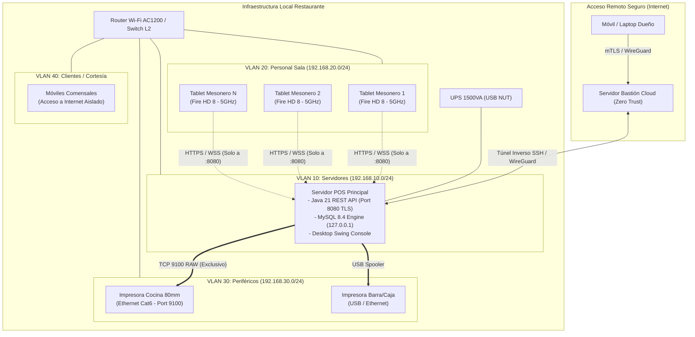
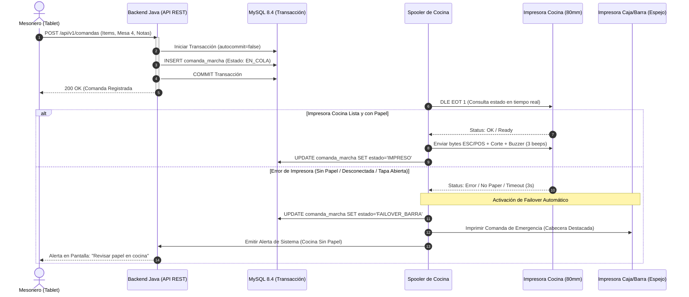
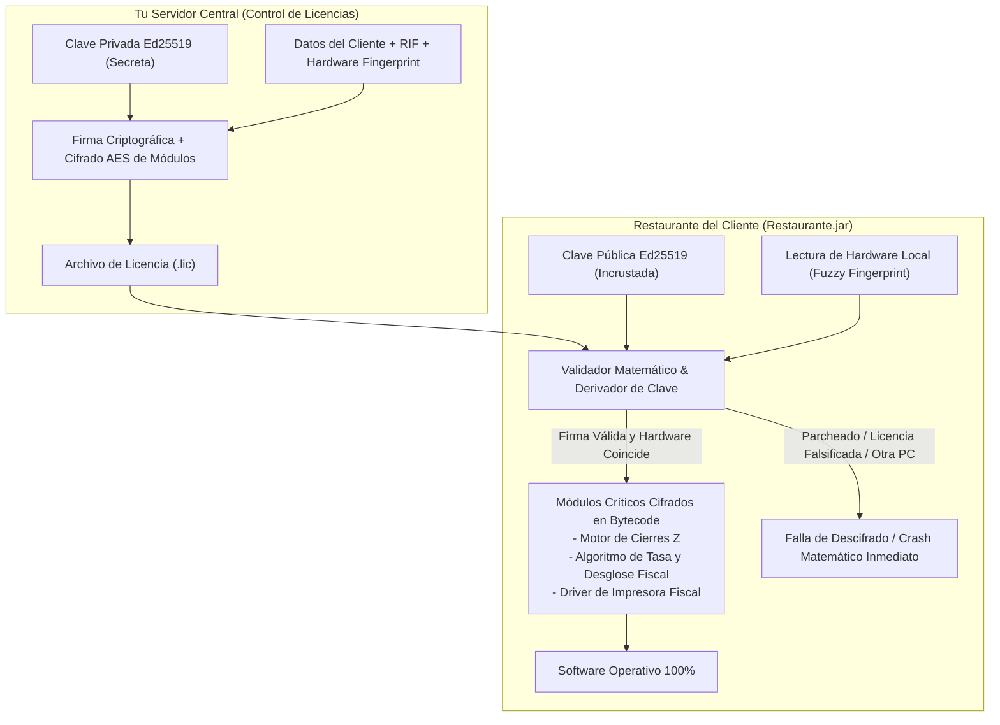
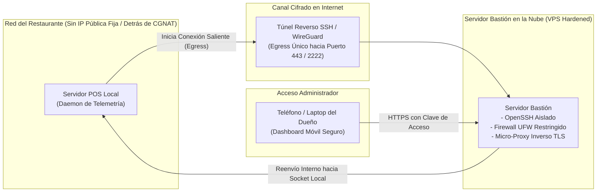
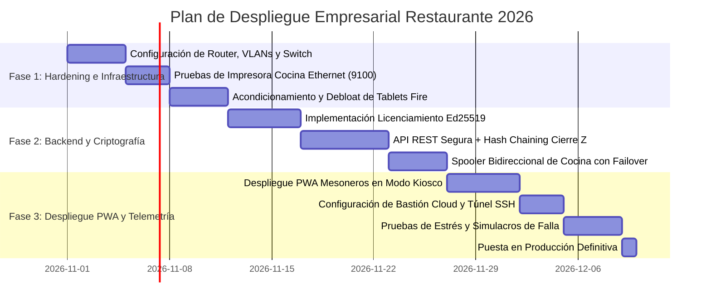

# Plan de Arquitectura Empresarial: Tablets, Comanderas, Monitoreo Remoto y Ciberseguridad
## Sistema Restaurante 2026 — Nivel Enterprise
**Versión:** 2.0 · **Fecha:** 25 de Octubre de 2026  
**Auditoría y Revisión:** Senior Adversarial Security Architect & Red Team Reviewer  
**Clasificación:** Documento Técnico y Guía de Implementación para Producción  

---

## 1. Resumen Ejecutivo y Alcance

El presente documento define la arquitectura técnica, operativa y de seguridad para transformar el sistema **Restaurante 2026** (originalmente un entorno monolítico Java 21 Swing + MySQL 8.4 en escritorio) en un **ecosistema distribuido de misión crítica**, diseñado para restaurantes de alto volumen con los siguientes pilares:

1. **Movilidad en Sala (Mesoneros):** Toma de pedidos en mesa mediante tablets **Amazon Fire HD 8 (3GB RAM)** ejecutando una Progressive Web App (PWA) ligera en modo Kiosco blindado, conectada a la API local del restaurante vía Wi-Fi dedicado.
2. **Impresión Térmica Desatendida en Cocina:** Despacho automático de rondas/comandas de cocina mediante impresora térmica de 80 mm Ethernet con cortador automático, timbre acústico y protocolo de confirmación física bidireccional.
3. **Monitoreo Remoto Seguro vía Internet:** Acceso gerencial en tiempo real desde el exterior (teléfono del dueño o administrador) a través de un **túnel reverso seguro (SSH/WireGuard)** con arquitectura Zero Trust, sin abrir puertos en el router del restaurante ni exponer MySQL a Internet.
4. **Licenciamiento Criptográfico Asimétrico y Anti-Piratería con IA:** Esquema basado en **Ed25519 con Node-Locking multinivel** y **descifrado funcional de código/datos**. Se neutralizan vectores de crackeo automatizado asistidos por agentes LLM (como REA/Ghidra) o clonación en máquinas virtuales (KVM/Proxmox).
5. **Vinculación Legal Inmutable (Desincentivo Fiscal):** Sello criptográfico de Razón Social y RIF/NIT inalterable en memoria, con encadenamiento criptográfico (*Hash Chaining*) en cada Cierre Z y factura. Cualquier copia ilegítima genera comprobantes legalmente inutilizables y fiscalmente peligrosos para el infractor.
6. **Resiliencia Operativa Total (Zero Data-Loss):** Operación local 100% autónoma ante caídas de Internet, con protección contra cortes eléctricos intempestivos mediante señalización UPS/NUT y configuración estricta de transacciones ACID en MySQL.

---

## 2. Especificaciones de Hardware y Periféricos

### 2.1. Terminales de Mesoneros (Tablets)
* **Dispositivo:** Amazon Fire HD 8 (Generación 12 / 2024).
* **Memoria RAM:** **3 GB** (Obligatorio. Las variantes de 2 GB sufren degradación con WebViews y son víctimas del `LowMemoryKiller` de Android en hora pico).
* **Almacenamiento:** 32 GB eMMC.
* **Pantalla:** 8.0 pulgadas IPS (1280 × 800 px). Peso: ~337 g (ergonómica para uso continuo con una sola mano durante turnos de 8 horas).
* **Conectividad:** Wi-Fi Dual Band (802.11 a/b/g/n/ac) con soporte nativo de **5 GHz**.
* **Batería:** 4850 mAh (hasta 13 horas de navegación web continua).
* **Accesorios Obligatorios de Grado Industrial:**
  - **Funda de Alto Impacto (Heavy Duty):** Armadura de policarbonato rígido + funda exterior de silicón grueso antichoque, con **correa de mano trasera giratoria 360° (*hand strap*)**. Permite al mesonero operar la tablet con una mano mientras queda sujeta firmemente a su palma, eliminando el riesgo de caída.
  - **Protector de Pantalla:** Vidrio templado 9H oleofóbico (resistente a grasa, salsas y humedad).
* **Estación de Carga Centralizada:** Cargador multipuerto inteligente de 60W–100W (Anker/Ugreen) con 6 a 8 puertos USB-C y cables trenzados de 90 grados, ubicado en la estación de mesoneros o caja.

### 2.2. Impresoras Térmicas de Tickets y Comandas
* **Impresora de Cocina (Comandera de Misión Crítica):**
  - **Modelo recomendado:** Xprinter XP-N160II / XP-C260M o Epson TM-T20III con interfaz **Ethernet (RJ-45)**.
  - **Papel:** Rollo térmico estándar de 80 mm de ancho (alta densidad).
  - **Velocidad:** $\ge 200\text{ mm/s}$ con cortador automático (*Auto-cutter*) de aleación de acero o cerámica (mínimo 1.5 millones de cortes).
  - **Alarma Acústica:** Buzzer/timbre interno de alta potencia ($\ge 85\text{ dB}$) configurable para emitir 3 pitidos al recibir cada comanda, garantizando que el personal de cocina escuche el ticket en ambientes ruidosos.
  - **Chasis y Protección:** Carcasa con deflectores antisalpicaduras de grasa y humedad.
* **Impresora de Caja (Facturación y Cierres):**
  - Impresora térmica 80 mm USB + interfaz RJ-11 para apertura automática de gaveta de dinero (12V/24V).

### 2.3. Infraestructura de Red Wi-Fi y Conmutación
* **Router Inalámbrico:** Router Gigabit Dual-Band AC1200 o Wi-Fi 6 AX1500 (ej. TP-Link Archer C64 / AX12 o Mercusys AC12G).
  - **4 antenas externas de alta ganancia (5 dBi).**
  - Procesador Dual-Core para evitar saturación de tablas NAT/DHCP con 15+ dispositivos concurrentes.
  - Soporte de **Aislamiento de Clientes (*Client Isolation / AP Isolation*)**.
* **Cableado:** Cable de red UTP Categoría 6 (Cat6) 100% cobre para conectar el Servidor POS y la impresora de cocina al router.

### 2.4. Respaldo Eléctrico (Protección de Integridad)
* **UPS / SAI:** Unidad interactiva de **1200 VA a 1500 VA** con regulación automática de voltaje (AVR) y puerto de comunicación USB (ej. APC Back-UPS o Forza).
* **Alimentación Protegida:** Servidor POS central, Router Wi-Fi e Impresora de Caja conectados a la UPS, brindando 25 a 45 minutos de autonomía operativa.

---

## 3. Topología de Red y Segmentación Física/Lógica



### Reglas de Enrutamiento y Firewall Local (Iptables / Router ACL):
1. **Aislamiento Total de Impresoras (Mitigación DoS Port 9100):**  
   `VLAN 30` (Impresoras) tiene **denegado todo tráfico de entrada** excepto las conexiones originadas desde la IP estática del Servidor POS (`192.168.10.10:9100`). Las tablets de los mesoneros tienen terminantemente prohibido comunicarse con las impresoras directamente.
2. **Aislamiento de Clientes Wi-Fi (*Client Isolation*):**  
   En `VLAN 20` (Tablets), el router bloquea el tráfico horizontal (L2/L3 entre tablets). Una tablet comprometida no puede escanear ni atacar a otra tablet.
3. **Restricción de Salida WAN:**  
   Las tablets y la impresora de cocina tienen bloqueada la salida a Internet en el firewall del router. Solo se comunican con la IP del servidor local, eliminando consumo de ancho de banda o navegación indebida.
4. **Frecuencia Inalámbrica 5 GHz Exclusiva:**  
   El SSID corporativo (`POS-OPERACIONES`) opera **únicamente en la banda de 5 GHz** en canales limpios (ej. canal 36 o 44). La banda de 2.4 GHz queda reservada exclusivamente para dispositivos IoT o clientes, protegiendo las comandas contra la interferencia de hornos microondas industriales.

---

## 4. Arquitectura de Software para Tablets de Mesoneros

### 4.1. Configuración del Dispositivo (Debloating & Kiosk Mode)
Para garantizar un rendimiento empresarial en las Amazon Fire HD 8:
1. **Debloat vía ADB (Android Debug Bridge):**
   Antes del despliegue, se ejecuta un script de limpieza para desinstalar paquetes innecesarios de Amazon (`com.amazon.kindle`, `com.amazon.mp3`, servicios de telemetría y anuncios). Esto libera **~900 MB de memoria RAM**, dejando más de 1.8 GB libres para el navegador.
2. **Bloqueo en Kiosk Mode (Fully Kiosk Browser):**
   - Se fija la URL de la aplicación: `https://192.168.10.10:8080/pwa/`.
   - **Bloqueo de hardware:** Barra de notificaciones oculta, barra de navegación bloqueada, botón de encendido reprogramado para no mostrar menú de apagado.
   - Salida del modo kiosco protegida por PIN criptográfico de administrador de 8 dígitos.
   - Activación de *Keep Awake* mientras la tablet esté en horario de servicio.

### 4.2. PWA Ligera y Protocolo de Comunicación
* **Servidor Local Autónomo:** El backend Java 21 expone un servidor HTTP/HTTPS interno de alto rendimiento (utilizando el motor integrado de Java 21 `com.sun.net.httpserver` o un micro-servidor embebido ligero como Javalin/Grizzly sin sobrecarga de frameworks pesados).
* **Seguridad de Capa de Transporte (TLS 1.3 Local):**
  Se genera una Autoridad Certificadora privada (`Restaurante Root CA`) cuyo certificado se instala en el almacén de certificados de confianza de las tablets Fire. Esto permite HTTPS y WebSockets seguros (`wss://`) sin advertencias de certificado en el navegador, requisito obligatorio de los estándares modernos para habilitar *Service Workers*.
* **Control de Acceso y RBAC Estricto (Zero Void Authority):**
  - Cada mesonero inicia sesión con un **PIN numérico de 4 dígitos**.
  - La sesión emite un token JWT de corta duración (firmado con HMAC-SHA256 y semilla rotativa diaria).
  - **Regla de Oro Operativa:** La tablet del mesonero **solo tiene autoridad aditiva** (abrir mesa, agregar platos, notas de cocina, solicitar cuenta). La PWA **NO TIENE ENDPOINTS PARA ELIMINAR PLATOS COMANDADOS NI ANULAR CUENTAS**. Si un cliente rechaza un plato servido, la anulación solo puede ser autorizada físicamente por el Administrador/Cajero en la pantalla principal de caja.

### 4.3. Flujo de Resiliencia Desconectada (Service Worker)
Si un mesonero camina hacia un rincón del salón con señal marginal:
1. El Service Worker almacena temporalmente la orden en `IndexedDB` local.
2. La interfaz muestra un indicador visual en color ámbar: `[Comanda pendiente de enlace]`.
3. Al restablecerse la señal Wi-Fi, la PWA despacha la cola automáticamente con cabeceras de **idempotencia** (`X-Idempotency-Key: UUID`), asegurando que la cocina jamás reciba platos duplicados ante reconexiones.

---

## 5. Subsistema de Impresión de Cocina de Misión Crítica



### Protocolo de Prevención de Fallos en Cocina:
1. **Comprobación Bidireccional Previa (`DLE EOT 1`):**  
   Antes de vaciar el búfer de impresión, el driver Java consulta el estado físico del cabezal y sensores de papel. Si la impresora está apagada, sin rollo o con la tapa abierta, el trabajo **no se envía al vacío**.
2. **Confirmación Transaccional:**  
   Un ítem comandado no se marca como servido/impreso hasta que el socket TCP devuelva confirmación exitosa de transmisión de bytes.
3. **Reenvío Automático (*Failover Mirroring*):**  
   Si la impresora de cocina no responde tras 3 intentos (backoff de 2 segundos), el spooler redirige automáticamente el ticket a la impresora de barra/caja con la leyenda:  
   `*** COMANDA DE EMERGENCIA - COCINA NO RESPONDE (MESA 4) ***`.

---

## 6. Licenciamiento Criptográfico Asimétrico y Anti-Tampering (Resistente a IA)

### 6.1. La Falla de los Métodos Convencionales ante Herramientas como REA
Los esquemas de licenciamiento tradicionales basados en comparaciones condicionales simples:
```java
// VULNERABILIDAD GRAVE: Fácilmente reversible por IA o crackers
if (!LicenciaServicio.esValida(licencia)) {
    System.exit(0);
}
```
Son completamente inútiles frente a descompiladores asistidos por IA (como el proyecto **REA** sobre Ghidra/JADX). Una LLM identifica el método en segundos y altera el bytecode (cambiando la instrucción de salto condicional `ifeq` por `nop` o forzando un retorno constante `true`).

### 6.2. La Solución: Descifrado Funcional (*Functional Cryptographic Decryption*)
En el modelo implementado para **Restaurante 2026**, la licencia no es una bandera de paso; **es la llave matemática para desbloquear el funcionamiento del software**:



#### Mecánica de Implementación:
1. **Firma Digital Ed25519:**  
   El archivo de licencia contiene el nombre del cliente, RIF, fecha límite, número de tablets autorizadas y el hash de hardware del equipo. Se firma con tu clave privada Ed25519.
2. **Derivación de Clave de Desbloqueo (PBKDF2 / HKDF):**  
   Al arrancar, la firma digital y los datos de hardware se combinan criptográficamente para derivar una clave simétrica **AES-256-GCM**.
3. **Ejecución Condicionada por Criptografía:**  
   Componentes esenciales (por ejemplo, la semilla que genera los correlativos fiscales y el formateador de Cierres Z) se almacenan cifrados. Si un atacante usa una herramienta de IA para saltarse el diálogo de licencia, la clave derivada será errónea y la primera factura o cierre de caja lanzará un error criptográfico irreversible (`AEADBadTagException`), impidiendo el uso del software.

### 6.3. Huella Digital de Hardware Heterogénea (*Node-Locking Tolerante*)
Para evitar bloqueos accidentales por cambio de un periférico menor, se utiliza un vector de coincidencia ponderada (*Fuzzy Hardware Matching*):

| Componente de Hardware | Vector Extraído | Peso | Método de Extracción Seguro |
|---|---|---|---|
| **Placa Madre** | UUID del Sistema + Serial de Fabricante | 40% | Lectura directa de tablas SMBIOS físicas |
| **Almacenamiento Primario** | Serial de Fábrica del SSD/NVMe | 30% | Comandos IOCTL directos (no WMI) |
| **Topología ACPI** | Hash de la tabla ACPI DSDT | 20% | Lectura del bus `/sys/firmware/acpi/tables/DSDT` |
| **Adaptador de Red Físico** | MAC Address de la interfaz Ethernet de placa | 10% | Filtrado de adaptadores físicos (excluyendo virtuales) |

* **Regla de Validación:** Si el equipo alcanza un puntaje de coincidencia $\ge 70\%$, la licencia se considera válida. Si se detecta un cambio (ej. reemplazo de disco duro), el sistema entra en modo de gracia de 7 días notificando al administrador para solicitar una actualización de licencia.
* **Anti-Clock Tampering (Protección contra retroceso de fecha):**  
  La base de datos almacena en cada transacción un contador monotónico y timestamp. Si en algún momento la fecha del reloj del sistema operativo es anterior a la fecha de la última factura registrada, el sistema entra en bloqueo de seguridad (`LOCKDOWN_MANIPULACION_FECHA`).

---

## 7. Vinculación Legal Inmutable (Desincentivo Fiscal)

La forma más contundente de evitar que terceros copien o revendan el software a otros establecimientos comerciales es el **desincentivo tributario**:

1. **Inyección Inmutable de Datos de Empresa:**  
   Los datos fiscales (Nombre de la Razón Social, RIF/NIT/RUC, dirección fiscal) **no son editables en la base de datos**. Vienen sellados dentro de la licencia criptográfica verificada en memoria.
2. **Encadenamiento Criptográfico de Facturas y Cierres Z (*Hash Chaining*):**  
   Cada factura cobrada y cada Cierre Z se registra con un hash encadenado acumulativo:
   $$\text{Hash}_n = \text{HMAC-SHA256}\Big(\text{Hash}_{n-1} \parallel \text{ID} \parallel \text{Correlativo} \parallel \text{Fecha} \parallel \text{Total} \parallel \text{RIF\_Licencia}, \text{SemillaSecreta}\Big)$$
3. **Efecto Disuasorio Práctico:**  
   Si una persona copia el software y su base de datos para instalarlo en otro restaurante:
   - Todas las comandas, pre-facturas, tickets finales y reportes de cierre Z se imprimirán de forma obligatoria con el nombre y RIF del restaurante original.
   - Ningún negocio puede operar formalmente emitiendo facturas con el RIF de otro contribuyente sin incurrir en delitos de defraudación tributaria y clausura inmediata por parte de las autoridades fiscales.

---

## 8. Monitoreo Remoto Seguro vía Internet (Túnel SSH / Zero Trust)

Para permitir que el dueño o administrador del restaurante supervise las ventas en vivo, ocupación de mesas y cierre diario desde su teléfono u hogar, sin exponer la red local del restaurante a ataques cibernéticos:



### 8.1. Especificación del Túnel Inverso Seguro
Dado que la mayoría de conexiones a Internet en restaurantes utilizan IP dinámica residencial o están detrás de **CGNAT** (sin posibilidad de abrir puertos en el módem del proveedor):
* El servidor del restaurante es quien **inicia la conexión saliente (*outbound/egress*)** hacia un servidor bastión en la nube (un VPS de bajo costo con IP fija).
* La conexión se realiza mediante una clave criptográfica privada **Ed25519** única por sucursal.

### 8.2. Hardening Extremo del Túnel SSH (OpenSSH)
En el servidor bastión remoto, la clave del restaurante se confina estrictamente en `/home/telemetria/.ssh/authorized_keys` con directivas que eliminan cualquier posibilidad de ejecución de comandos interactivos o pivote lateral:

```sshd
# Confinamiento estricto: Cero terminal interactiva, cero agentes, solo reenvío de puerto de métricas
command="/bin/false",no-agent-forwarding,no-user-rc,no-X11-forwarding,no-pty,permitopen="127.0.0.1:8080" ssh-ed25519 AAAAC3NzaC1lZDI1NTE5AAAAI... pos-sucursal-01
```

* **Servicio Systemd Local con Sandboxing (`/etc/systemd/system/pos-tunnel.service`):**  
  El proceso local se ejecuta bajo un usuario sin privilegios (`pos-tunnel`), con directivas de seguridad del kernel de Linux:
  - `ProtectSystem=strict` (sistema de archivos de solo lectura).
  - `ProtectHome=yes` (bloqueo total de carpetas personales).
  - `NoNewPrivileges=yes` (imposibilidad de escalada a root).
  - Reconexión automática infinita con `Restart=always` y `RestartSec=15`.

---

## 9. Matriz de Vectores de Ataque Adversarial y Contramedidas

A continuación se resumen los hallazgos del análisis de seguridad adversarial y las defensas implementadas:

| Vector de Riesgo | Superficie Evaluada | Falla Habitual de Implementación | Contramedida Empresarial Implementada |
|---|---|---|---|
| **1. DoS en Cocina** | Impresora térmica Ethernet (Puerto RAW 9100) | Enviar bytes sin verificar estado físico de papel ni aislar la red de comensales. | VLAN de periféricos aislada; handshake bidireccional de estado (`DLE EOT 1`) y failover automático a barra. |
| **2. Fuga de Kiosco y Fraude de Anulación** | Tablets Amazon Fire HD 8 / PWA | Almacenar tokens JWT eternos en `localStorage` y permitir cancelaciones desde la tablet. | Debloat de Fire OS; bloqueo con Fully Kiosk; regla de **Zero Void Authority** (anulaciones solo en caja con PIN de supervisor). |
| **3. Interferencia RF y Rogue APs** | Red Wi-Fi en sala | Uso de 2.4 GHz (colapso por microondas) y tráfico HTTP sin cifrar en LAN. | Exclusividad total de 5 GHz en SSID operativo; TLS 1.3 con CA privada; Client Isolation activo. |
| **4. Crackeo de Licencia con IA** | Binario Java / `Restaurante.jar` | Uso de condicionales booleanos (`if (!valida) exit`) y reloj del sistema operativo. | **Descifrado funcional:** la licencia es la clave AES que descifra rutinas de facturación; monotonía temporal en BD. |
| **5. Compromiso de Túnel Remoto** | Conectividad remota vía SSH | Uso de contraseñas débiles, claves compartidas y shells interactivos `/bin/bash`. | Claves Ed25519 con directiva `command="/bin/false",no-pty`; sandboxing de Systemd; denegación total a puerto MySQL. |
| **6. Corte Eléctrico en Pico de Servicio** | Corrupción de base de datos MySQL | Búferes InnoDB no sincronizados al ocurrir el apagón. | UPS de 1500VA con demonio NUT; `innodb_flush_log_at_trx_commit=1`; script de apagado limpio tras 4 min de corte. |

---

## 10. Cronograma de Implementación por Fases



### Criterios de Aceptación para Salida a Producción:
* **Prueba de Fuego en Cocina:** Simular corte de papel y desconexión de cable en la impresora de cocina durante un pedido activo: la comanda debe redirigirse automáticamente a la impresora de caja en menos de 5 segundos con aviso al personal.
* **Prueba de Falla Eléctrica:** Desconectar la alimentación principal de la pared: la UPS debe mantener el sistema operativo y, tras 4 minutos continuos de batería, ejecutar el apagado controlado sin una sola transacción huérfana en `pedidos` ni corrupción en InnoDB.
* **Prueba de Seguridad Inalámbrica:** Verificar que ningún dispositivo conectado al Wi-Fi de clientes pueda hacer ping o acceder al puerto 8080 del servidor POS ni al puerto 9100 de las tickeras.
* **Prueba de Integridad de Licencia:** Intentar ejecutar el sistema con una fecha adulterada o en una máquina clonada: el sistema debe abortar de inmediato sin desbloquear los módulos de facturación.
